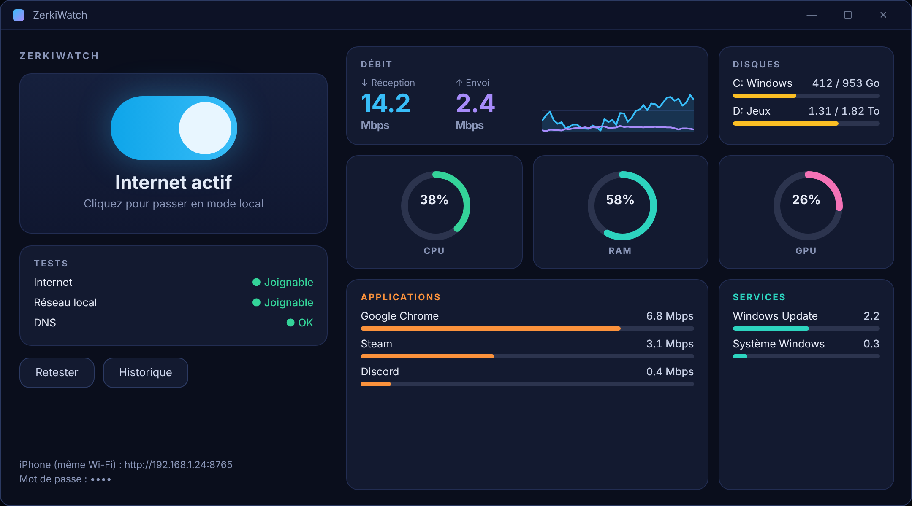
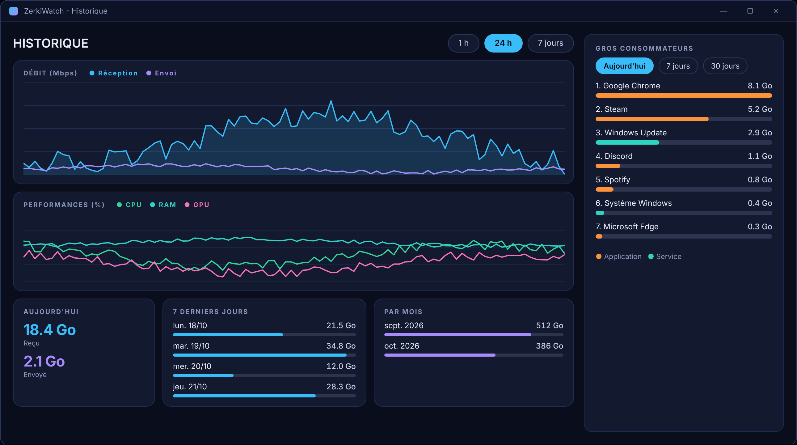
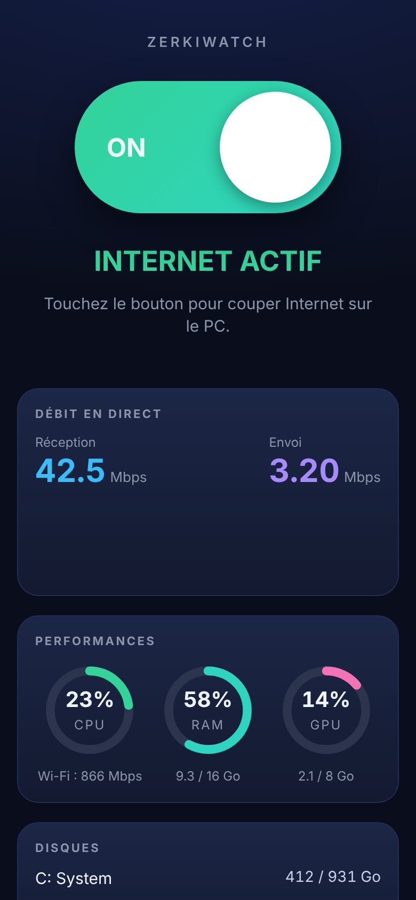

# ZerkiWatch

**Un clic pour couper Internet en gardant le réseau local. Surveillance du PC en direct. Télécommande iPhone.**

Gratuit et open source · Windows 10 / 11 · un seul fichier `.bat` · 6 langues

[English](README.md) · [Français](README.fr.md)

    

> ### 🤝 On cherche de l'aide — le projet est ouvert à tous
> ZerkiWatch est un projet jeune et ouvert : **toute contribution est la bienvenue**, même petite — corriger une faute, traduire l'application dans votre langue, la tester sur votre PC, signaler un bug, proposer une idée ou envoyer du code.
> Commencez par [CONTRIBUTING.md](CONTRIBUTING.md) — et si votre langue n'existe pas encore, [l'ajouter = un seul petit fichier texte](docs/TRANSLATING.md).

> Les captures du bureau ci-dessous sont des **illustrations** fidèles aux couleurs de l'application, pas de vraies captures. Les images de la page iPhone sont de vrais rendus de la vraie page web avec des données d'exemple. Vos vraies captures d'écran sont les bienvenues — voir [CONTRIBUTING.md](CONTRIBUTING.md#screenshots).

## Ce que ça fait

ZerkiWatch bascule votre PC entre le mode **Internet** et le mode **Local uniquement** grâce aux règles du pare-feu Windows, et montre en direct ce que fait votre machine (débit, processeur, mémoire, carte graphique, disques, consommation par application et par service Windows).

### Couper / remettre Internet
- Un bouton (ou un raccourci clavier global) passe en **mode local** : Internet est bloqué, mais le réseau domestique (imprimante, NAS, serveur multimédia, téléphone…) reste joignable.
- Seules des règles du pare-feu Windows sont créées (groupe `ZerkiWatch-LocalOnly`). Rien n'est installé dans le système, et repasser en mode Internet les supprime.
- Tests de connexion intégrés (Internet, réseau local).

### Surveillance en direct
- **Débit** de réception et d'envoi avec courbe.
- **CPU**, **RAM**, **GPU** et mémoire vidéo.
- **Tous les disques** (espace utilisé et activité), vous choisissez ceux à afficher.
- **Applications et services Windows** qui utilisent le réseau, mesurés séparément (traçage ETW).

### Historique et classement
- Moyennes **par minute** du débit, du CPU, de la RAM et du GPU, gardées **7 jours**.
- Totaux par jour gardés sans limite (aujourd'hui, 7 derniers jours, par mois).
- **Top 10 des plus gros consommateurs** (applications et services) sur aujourd'hui, 7 jours et 30 jours.

### Barre flottante et barre des tâches
- Une petite **barre flottante** toujours visible (débit, CPU, RAM, GPU, disque) ; clic sur la pastille pour basculer.
- **Intégrer à la barre des tâches** place la barre à côté de l'horloge et la cache en plein écran.
- Icône près de l'horloge, menu clic droit, lancement avec Windows.

### Télécommande iPhone
Une page web sur le Wi-Fi de la maison (port `8765`), protégée par un mot de passe :
- bascule Internet / Local, débit, CPU, RAM, GPU, disques, historique et classement ;
- carte **Alimentation** : verrouiller, éteindre l'écran, veille, redémarrer, éteindre (confirmation et 30 s pour annuler) ;
- **installable sur l'écran d'accueil** (plein écran, icône) ;
- points d'accès texte pour l'app **Raccourcis** d'Apple.

### Langues
English, Français, Español, Deutsch, Italiano, Português. La langue suit Windows par défaut et se change depuis le menu de l'icône (**Langue**). La page iPhone utilise la même langue. **Ajouter une langue = ajouter un fichier texte** → [docs/TRANSLATING.md](docs/TRANSLATING.md).

## Installation

### Option 1 : lancer directement
1. Téléchargez `ZerkiWatch.bat` (et `ZerkiWatch.ico` pour l'icône).
2. Double-clic et acceptez la fenêtre administrateur (nécessaire pour modifier le pare-feu).

> Windows peut afficher un avertissement SmartScreen pour un `.bat` téléchargé : tout le code est lisible dans le fichier, c'est le but du projet.

### Option 2 : installer
Mettez `Installer.bat` à côté de `ZerkiWatch.bat` (ou `ZerkiWatch.exe`), double-clic puis **1 – Installer** : copie dans `Program Files\ZerkiWatch`, raccourcis bureau et menu Démarrer, lancement automatique optionnel, désinstallation propre (**2 – Désinstaller**, qui remet aussi Internet).

### Option 3 : fabriquer un `.exe`
Lancez `Build-EXE.bat` (Internet requis une fois pour télécharger l'outil gratuit [PS2EXE](https://github.com/MScholtes/PS2EXE)). Un `.exe` non signé peut déclencher SmartScreen.

### Mise à jour depuis « Mode réseau »
ZerkiWatch est le nouveau nom de *Mode réseau*. Au premier lancement, il **récupère vos réglages et votre historique** depuis `%APPDATA%\ModeReseau`, reconnaît les anciennes règles du pare-feu (elles sont remplacées au prochain changement de mode) et renomme l'ancienne tâche de lancement avec Windows. Supprimez ensuite l'ancien `Mode-Reseau.bat`.

## Utiliser la télécommande iPhone
1. L'adresse (`http://192.168.x.x:8765`) et le mot de passe sont affichés en bas de la fenêtre principale (menu de l'icône → *Télécommande iPhone…* pour les lire ou les changer).
2. Ouvrez l'adresse dans Safari et saisissez le mot de passe.
3. Partager → **Sur l'écran d'accueil**.

Le mot de passe par défaut est **aléatoire** (6 chiffres, généré au premier lancement, stocké dans `%APPDATA%\ZerkiWatch\password.txt`). Changez-le depuis le menu de l'icône : *Télécommande iPhone…*. Le lien en bas de la page web ne fait que mémoriser le mot de passe dans le téléphone, il ne change pas celui du PC.

### Raccourcis Apple
| Action | Requête |
|---|---|
| État en une ligne | `GET /api/short?pin=…` (option `&f=state`, `speed`, `cpu` ou `ram`) |
| Basculer Internet / Local | `GET` ou `POST /api/toggle?pin=…` |

Dans l'app Raccourcis : **Obtenir le contenu de l'URL**, puis **Afficher le résultat** ou **Afficher la notification**.

### API (protégée par l'en-tête `X-Pin` ou `?pin=`)
Voir le tableau dans le [README anglais](README.md#api-protected-by-x-pin-header-or-pin). Après 5 mots de passe erronés, l'accès est bloqué 60 secondes.

## Données enregistrées
Tout est dans `%APPDATA%\ZerkiWatch` : `history.csv` (moyennes par minute, 7 jours), `totals.csv` (octets par jour), `apps.csv` (par application et par jour, 35 jours), `config.txt` (réglages, langue), `password.txt` (mot de passe iPhone), `log.txt` (journal, rotation à 400 Ko).

## Limites et sécurité
- **Windows 10/11 uniquement**, pare-feu Windows actif, droits administrateur requis.
- La page iPhone est en **HTTP non chiffré sur votre réseau local** : utilisez un mot de passe personnel et n'exposez jamais le port sur Internet (pas de redirection de port).
- Le mode local autorise les adresses privées (10.x, 172.16–31.x, 192.168.x, lien-local) ; un VPN ou un service passant par une adresse privée peut rester joignable.
- Sous Windows 11, la barre « intégrée » est une fenêtre posée sur la barre des tâches : elle peut recouvrir des icônes sur un écran étroit.
- La mesure par application utilise le traçage réseau de Windows (ETW) et reste active en arrière-plan ; un interrupteur du menu la coupe.
- **État : début de projet.** Il a été développé pas à pas et surtout testé par son auteur ; attendez-vous à des aspérités sur d'autres configurations — [ouvrez un ticket](../../issues).

Problème de sécurité : voir [SECURITY.md](SECURITY.md).

## Soutenir le projet
ZerkiWatch est gratuit et le restera. S'il vous est utile, vous pouvez [m'offrir un café sur Ko-fi ☕](https://ko-fi.com/zerkino) — ce n'est jamais obligatoire, et contribuer par du code, des traductions ou des signalements de bugs aide tout autant.

## Contribuer
Tout le monde est le bienvenu, débutants compris. Lisez [CONTRIBUTING.md](CONTRIBUTING.md). Pour aider : **traduire**, **tester**, **signaler des bugs**, **partager de vraies captures**, **améliorer le code ou la doc**, **relire la sécurité**.

## Licence
[MIT](LICENSE) — libre d'utilisation, de modification et de partage.
