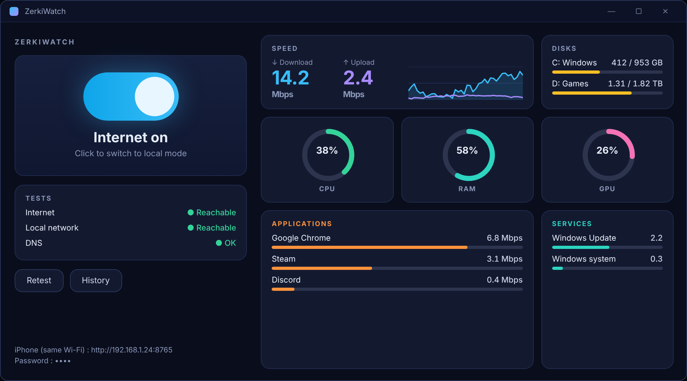
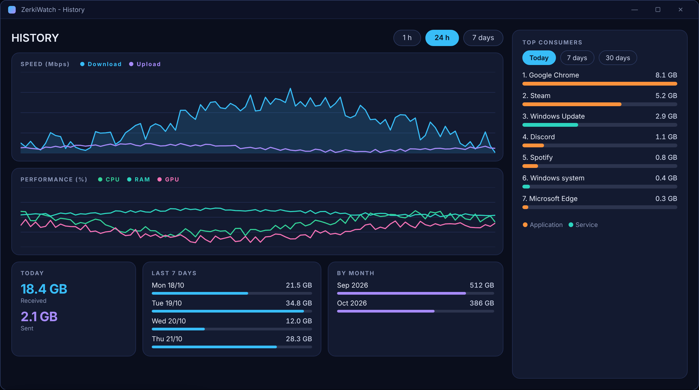
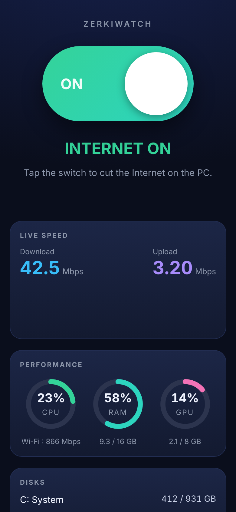

<div align="center">

# ZerkiWatch

**Network speed meter in the Windows taskbar (download / upload, CPU, RAM, GPU) — plus a one-click Internet kill switch that keeps your local network (Plex, NAS…) and an iPhone remote.**

Free and open source · Windows 10 / 11 · single `.bat` file · 6 languages

[English](README.md) · [Français](README.fr.md)

    [](https://ko-fi.com/zerkino)

</div>

> ### 🤝 Help wanted — this project is open to everyone
> ZerkiWatch is a young, community-friendly project and **contributions of any size are welcome**: fixing a typo, translating the app into your language, testing it on your PC, reporting a bug, suggesting a feature or sending code.
> Start with [CONTRIBUTING.md](CONTRIBUTING.md) — and if you speak a language that is not available yet, [adding it takes one small text file](docs/TRANSLATING.md).




## What it does

ZerkiWatch puts your **live internet speed (download / upload), CPU, RAM, GPU and disk usage in the Windows 10 / 11 taskbar**, next to the clock, and shows which apps and services use your bandwidth. It also acts as a **firewall-based Internet on/off switch** that keeps your local network working (Plex, NAS, printer, media server…). It switches your PC between **Internet** mode and **Local only** mode using Windows Firewall rules, and shows live what your machine is doing (network speed, CPU, RAM, GPU, disks, bandwidth per application and Windows service).

### Cut / restore the Internet
- One button (or a global keyboard shortcut) switches to **local mode**: the Internet is blocked but your home network (printer, NAS, media server, phone…) stays reachable.
- It only creates Windows Firewall rules (group `ZerkiWatch-LocalOnly`). Nothing is installed in the system, and going back to Internet mode deletes them.
- Built-in connection tests (Internet, local network).

### Live monitoring
- Download / upload **speed** with a graph.
- **CPU**, **RAM**, **GPU** and video memory.
- **All disks** (used space and activity), you choose which ones to display.
- **Applications and Windows services** using the network, measured separately with ETW tracing.

### History and ranking
- Per-minute averages of speed, CPU, RAM and GPU, kept **7 days**.
- Daily totals kept without limit (today, last 7 days, by month).
- **Top 10 consumers** (apps and services) for today, 7 days and 30 days.



### Network speed in the taskbar (floating bar)
- A small always-visible **floating bar** (speed, CPU, RAM, GPU, disk); click the dot to toggle.
- **Integrate into the taskbar** places the bar next to the clock and hides it in full screen.
- Tray icon, right-click menu, start with Windows.


### iPhone remote
A web page served on your home Wi-Fi (port `8765`), protected by a password:
- toggle Internet / Local, speed, CPU, RAM, GPU, disks, history and ranking;
- **Power** card: lock, turn off the screen, sleep, restart, shut down (with confirmation and 30 s to cancel);
- can be **added to the home screen** (full screen app, icon);
- plain-text endpoints for Apple's **Shortcuts** app.

<p align="center"></p>

### Languages
English, Français, Español, Deutsch, Italiano, Português. The language follows Windows by default and can be changed from the tray menu (**Language**). The iPhone page uses the same language. **Adding a language = adding one text file** → [docs/TRANSLATING.md](docs/TRANSLATING.md).

## Install

### Option 1: just run it
1. Download `ZerkiWatch.bat` (and `ZerkiWatch.ico` if you want the icon).
2. Double-click and accept the administrator prompt (needed to change the firewall).

> Windows may show a SmartScreen warning for a downloaded `.bat`: the whole source is readable in the file, that is the point of this project.

### Option 2: install
Put `Installer.bat` next to `ZerkiWatch.bat` (or `ZerkiWatch.exe`), double-click and choose **1 – Install**: copies to `Program Files\ZerkiWatch`, creates desktop / Start menu shortcuts, optional start with Windows, clean uninstall (**2 – Uninstall**, which also restores Internet).

### Option 3: build an `.exe`
Run `Build-EXE.bat` (needs Internet once to download the free [PS2EXE](https://github.com/MScholtes/PS2EXE)). An unsigned `.exe` may trigger SmartScreen.

### Upgrading from "Mode réseau"
ZerkiWatch is the new name of *Mode réseau*. On first start it **migrates your settings and history** from `%APPDATA%\ModeReseau`, recognises the old firewall rules (they are replaced the next time you switch mode) and moves the old start-with-Windows task to the new name. Delete the old `Mode-Reseau.bat` afterwards.

## Using the iPhone remote
1. The address (`https://192.168.x.x:8765`) and the password are shown at the bottom of the main window (tray menu → *iPhone remote…* to read or change them).
2. **One-time setup:** install the ZerkiWatch certificate on the iPhone (see below), otherwise Safari shows a security warning.
3. Open the address in Safari and enter the password.
4. Share → **Add to Home Screen**.

The default password is **random** (6 digits, generated on first start, stored in `%APPDATA%\ZerkiWatch\password.txt`). Change it from the tray menu: *iPhone remote…*. The link at the bottom of the web page only stores the password in your phone — it does not change the PC password.

### HTTPS certificate on the iPhone (one time)
ZerkiWatch creates its own local certificate authority (`ZerkiWatch Local CA`, stored in the Windows certificate store of your PC) and a server certificate for your PC's local IP. To make the iPhone trust it:
1. On the PC: tray menu → *iPhone remote…* → **iPhone certificate**. The public file `ZerkiWatch-CA.cer` is saved on your Desktop and the SHA-256 fingerprint is shown.
2. Send it to the iPhone (AirDrop, mail, iCloud Drive), or open `https://<PC address>:8765/ca.cer` in Safari (accept the one-time warning: only the public certificate is downloaded) and tap *Allow*.
3. iPhone: **Settings → Profile Downloaded → Install**.
4. iPhone: **Settings → General → About → Certificate Trust Settings** → turn **ON** *ZerkiWatch Local CA*.
5. Compare the SHA-256 fingerprint shown in the certificate details with the one displayed on the PC.

The private key never leaves the PC. If your PC's IP changes, ZerkiWatch re-issues the server certificate on the next start; the iPhone keeps trusting it. If the certificate cannot be set up, the remote does **not** start (no HTTP fallback) and the reason is shown in the main window. After switching from HTTP, re-enter the password once in Safari and re-add the Home Screen icon.

### Apple Shortcuts
| Action | Request |
|---|---|
| One-line state | `GET /api/short` + header `X-Pin: <password>` (option `&f=state`, `speed`, `cpu` or `ram`) |
| Toggle Internet / Local | `GET` or `POST /api/toggle` + header `X-Pin: <password>` |

In the Shortcuts app: **Get Contents of URL** (show *More*, add the header `X-Pin`), then **Show Result** or **Show Notification**.

### API (protected by the `X-Pin` header — the password is never accepted in the URL)
| Route | Method | Purpose |
|---|---|---|
| `/api/status` | GET | state, speed, CPU/RAM/GPU, disks, apps |
| `/api/set?mode=local\|internet` | POST | force a mode |
| `/api/toggle` | GET, POST | toggle |
| `/api/short` | GET | short text for Shortcuts |
| `/api/history?range=1h\|24h\|7d` | GET | graphs, totals, ranking |
| `/api/power?action=lock\|screen\|sleep\|restart\|shutdown\|cancel` | POST | power |
| `/`, `/manifest.webmanifest`, `/icon-*.png` | GET | the page and install files (no password) |

After 5 wrong passwords the access is blocked for 60 seconds.

## Saved data
Everything is in `%APPDATA%\ZerkiWatch`:

| File | Content | Kept |
|---|---|---|
| `history.csv` | per-minute averages (speed, CPU, RAM, GPU) | 7 days |
| `totals.csv` | bytes per day | unlimited |
| `apps.csv` | bytes per application / service per day | 35 days |
| `config.txt` | bar position, options, language | — |
| `password.txt` | iPhone remote password | — |
| `log.txt` | errors and events | rotated at 400 KB |

## Limits and security
- **Windows 10/11 only**, with Windows Firewall enabled. Administrator rights required.
- The iPhone page is served over **HTTPS on your local network** with a local certificate authority created on your PC. Never expose the port to the Internet (no port forwarding).
- Local mode allows private addresses (10.x, 172.16–31.x, 192.168.x, link-local). A VPN or a service going through a private address may stay reachable.
- On Windows 11 the "integrated" bar is a window placed over the taskbar (Microsoft no longer allows real toolbars): it may cover icons on a narrow screen; only the horizontal taskbar of the main screen is handled.
- Per-app measurement uses Windows network tracing (ETW) and stays on in the background to accumulate totals; a menu switch turns it off.
- **Status: early stage.** It was developed step by step and has been tested mainly by its author; expect rough edges on other setups — please [open an issue](../../issues).

Security issues: see [SECURITY.md](SECURITY.md).

## Project layout
```
ZerkiWatch.bat     the whole app (a .bat that launches an embedded PowerShell script)
lang/*.txt         one file per language (source of truth for all texts)
tools/             embed-lang.ps1, check-lang.ps1, check-syntax.ps1
Installer.bat      installer / uninstaller
Build-EXE.bat      builds ZerkiWatch.exe
docs/              translating guide, architecture notes, images
```
See [docs/ARCHITECTURE.md](docs/ARCHITECTURE.md) for how it works.

## Support the project
ZerkiWatch is free and will stay free. If it is useful to you, you can [buy me a coffee on Ko-fi ☕](https://ko-fi.com/zerkino) — it is never required, and contributing code, translations or bug reports helps just as much.

## Contributing
Everyone is welcome — beginners included. Read [CONTRIBUTING.md](CONTRIBUTING.md). Ways to help: **translate**, **test**, **report bugs**, **share real screenshots**, **improve the code or the docs**, **review security**.

## License
[MIT](LICENSE) — free to use, modify and share.
